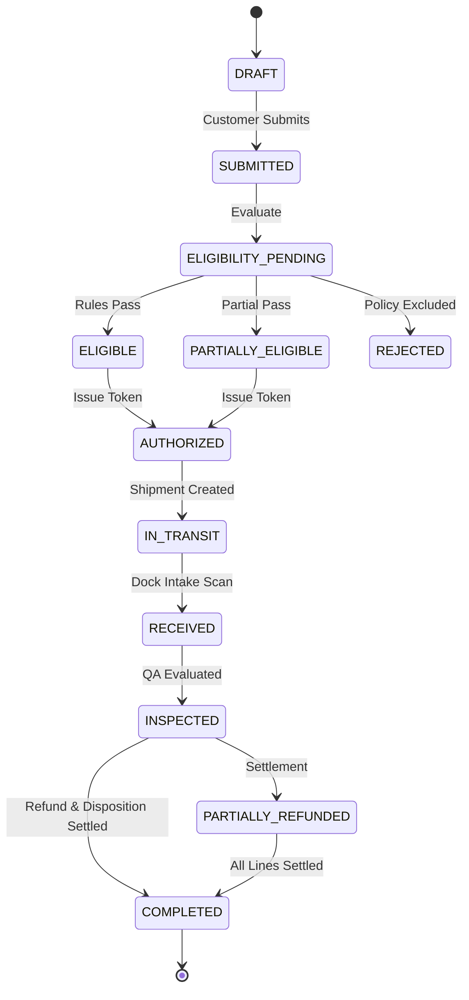

# System Architecture & Technical Specifications

## 1. Overview

The **Yotaa AI Returns Management & Audit Platform** is an enterprise-grade, end-to-end reverse logistics, refund reconciliation, and audit platform built for high-throughput ecommerce operations.

It is designed to automate complex return workflows while strictly enforcing multi-tenant business rules, financial boundaries, and physical inventory routing:

```
[Customer Return Request] ──> [Rule Engine Eligibility] ──> [Deterministic Authorization]
                                                                      │
[Audit Trail (EVT)] <── [Stock Movement (MOV)] <── [Warehouse Inspection (INS)] <── [Shipment Intake (RTS)]
        │                                                                      │
        └── [Idempotent Refund (REF)] <── [Inventory Disposition (DISP)] <─────┘
```

---

## 2. Monorepo Structure

```
returns-management-platform/
├── backend/
│   ├── app/
│   │   ├── main.py                     # FastAPI application entrypoint & middleware
│   │   ├── core/                       # Config settings, security, and directory paths
│   │   ├── db/                         # SQLAlchemy 2.0 Base, engine, and session factory
│   │   ├── models/                     # 16 Relational entity models with type annotations
│   │   ├── schemas/                    # Pydantic v2 validation and serialization schemas
│   │   ├── api/                        # REST endpoint routers with pagination & filters
│   │   ├── services/                   # Business domain services (returns, shipments, refunds, etc.)
│   │   ├── rules/                      # Pure, testable deterministic business rule engines
│   │   ├── analytics/                  # Ground-truth evaluation, confusion matrix & metrics
│   │   ├── generator/                  # Deterministic synthetic data generator & validator CLI
│   │   └── validators/                 # Hard-invariant validation suite engine
│   ├── tests/                          # Automated pytest suite covering all business scenarios
│   ├── migrations/                     # Alembic database migration scripts & env.py
│   ├── Dockerfile                      # Backend container configuration
│   └── requirements.txt                # Pinned production Python dependencies
├── frontend/
│   ├── src/
│   │   ├── api/                        # Axios HTTP client configured for backend proxy
│   │   ├── types/                      # Full TypeScript interfaces for entities & payloads
│   │   ├── components/                 # Reusable UI components (Sidebar, Navbar, Badge, Modal, etc.)
│   │   ├── layouts/                    # Main responsive light-theme layout
│   │   ├── pages/                      # 14 Production views
│   │   ├── App.tsx                     # React Router 7 route definitions
│   │   └── index.css                   # Tailwind CSS styling with clean light-theme typography
│   ├── package.json                    # Frontend dependencies and build scripts
│   ├── vite.config.ts                  # Vite + Tailwind v4 configuration
│   └── Dockerfile                      # Multi-stage production Nginx frontend container
├── data/
│   ├── starter/                        # Deterministic starter profile exports & manifest
│   ├── exports/                        # Full profile dataset exports
│   ├── ground_truth/                   # Labelled negative anomaly fixtures (CSV & JSON)
│   └── validation/                     # Machine-readable validation reports
├── docs/
│   ├── architecture.md                 # System architecture & technical specifications
│   ├── data_dictionary.md              # Complete data dictionary for all entities & fields
│   ├── business_rules.md               # Detailed refund arithmetic, eligibility & disposition rules
│   ├── erd.md                          # Entity-Relationship diagram in Mermaid
│   └── evaluation.md                   # Evaluation metrics, confusion matrix & benchmark report
├── scripts/
│   └── verify_reproducibility.py       # Acceptance script verifying identical SHA-256 checksums
├── docker-compose.yml                  # Full multi-container composition (MySQL + Backend + Frontend)
├── .env.example                        # Environment variable template
├── .gitignore                          # Clean repository ignore rules
├── README.md                           # Comprehensive operator and developer guide
└── LICENSE                             # MIT License
```

---

## 3. Technology Stack & Design Decisions

### 3.1 Backend
- **Python 3.12+ & FastAPI**: High-performance asynchronous REST API framework with native OpenAPI/Swagger self-documentation.
- **SQLAlchemy 2.0 (Mapped Column Syntax)**: Strictly typed ORM models with composite indices, foreign keys, and cascading relationships.
- **SQLite & MySQL**: Out-of-the-box zero-configuration SQLite for instant local verification and automated testing, with seamless MySQL 8.0 support via PyMySQL in containerized deployment.
- **Decimal Fixed-Point Arithmetic**: All monetary calculations use `Decimal` with `ROUND_HALF_UP` to two decimal places (`0.01`). Floating-point arithmetic is strictly prohibited for money.
- **Alembic**: Database migrations tracking initial schema creation and future schema changes.

### 3.2 Frontend
- **React 19 & TypeScript**: Strict type safety ensuring zero runtime undefined property crashes.
- **Vite & Tailwind CSS v4**: Blazing fast compilation and clean light-theme styling.
- **Recharts**: Responsive visual charts for returns breakdown, disposition donut charts, and reason category distributions.
- **Axios & React Router 7**: Declarative routing across 14 dedicated operational and audit pages.

---

## 4. Multi-Stage Reverse Logistics Lifecycle

Every return request traverses a deterministic state machine:



---

## 5. Security & Invariant Safeguards

1. **Idempotency Guard**: Every refund requires an `idempotency_key`. Repeating a request with an existing idempotency key yields `BLOCKED_DUPLICATE` without creating any duplicate payout.
2. **Paid Amount Ceiling**: Total refunds for any order line cannot exceed the net amount paid by the customer after discounts and taxes.
3. **Physical Intake Invariant**: Physical items cannot be routed to `RESTOCK` before confirmed receipt (`DELIVERED`) and passing inspection (`PASS` or `PASS_WITH_RESTOCKING_FEE`).
4. **Append-Only Audit Trail**: State transitions, supervisor overrides, and logistics events are logged in an append-only `return_events` table that cannot be silently modified.
5. **Admin Header Protection**: Administrative operations (such as batch data generation) require `X-Admin-Key` header authentication.

