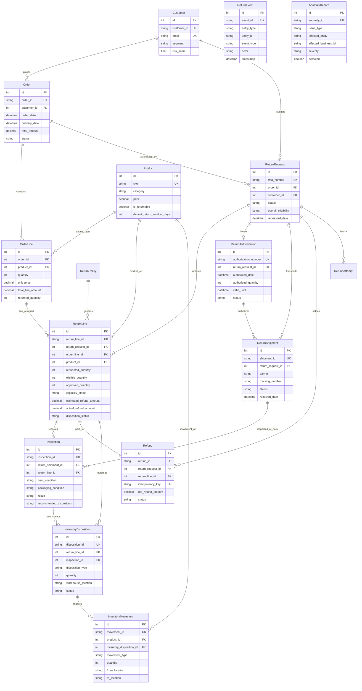

# Entity-Relationship Diagram (ERD)

The following Mermaid diagram visualizes all core entities, foreign key relationships, and cardinalities:

---

## Cardinalities & Relational Constraints

1. **Customer 1:N Order**: A customer may place multiple orders; an order belongs to exactly one customer.
2. **Order 1:N OrderLine**: An order contains one or more line items (`cascade="all, delete-orphan"`).
3. **Order 1:N ReturnRequest**: A customer may initiate multiple return requests for an order (e.g. for different items or dates).
4. **ReturnRequest 1:N ReturnLine**: An RMA encompasses one or more return lines.
5. **ReturnRequest 0:1 ReturnAuthorization**: Exactly one authorization token per RMA (`unique=True, index=True`).
6. **ReturnAuthorization 1:N ReturnShipment**: An authorization may involve multiple shipments if split reverse logistics are required.
7. **ReturnShipment 1:N Inspection**: Physical items in a shipment are inspected individually.
8. **ReturnLine 1:N Refund**: Supports multiple refund installments or single complete payout.
9. **ReturnLine 0:N InventoryDisposition**: Supports split dispositions when inspected units have different physical conditions (e.g., 1 unit restocked, 1 unit scrapped).
10. **InventoryDisposition 1:N InventoryMovement**: Every inventory disposition generates auditable physical stock ledger movements.
